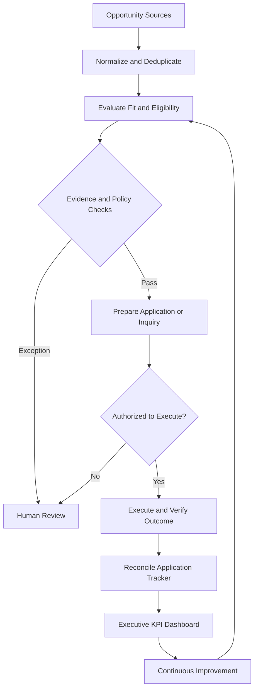

# AI-Assisted Executive Workflow — Reference Architecture

## Operating Model

## Operational Controls

- Human accountability for consequential decisions.
- Verified experience and accomplishments before tailoring applications.
- Explicit authorization boundaries for external communication.
- Confirmation before recording an application as submitted.
- Exception management and aging criteria.
- Reconciliation across email, application tracking, and scheduled workflows.

## Performance Measurement

| KPI | Measurement |
|---|---|
| Automation coverage | Automated eligible tasks / total eligible tasks |
| SLA attainment | On-time runs / expected scheduled runs |
| Decision quality | Audited decisions passing criteria / decisions audited |
| Cycle time | Time from opportunity intake to verified disposition |
| Outcome conversion | Qualified opportunities advanced / qualified opportunities reviewed |

## Evidence Classification

1. Conceptual design
2. Implemented prototype
3. Observed operational workflow
4. Validated business outcome

Each published result must identify its evidence classification.

## Current Status

This document describes the reference architecture. It does not assert that every integration or workflow has been independently validated.
